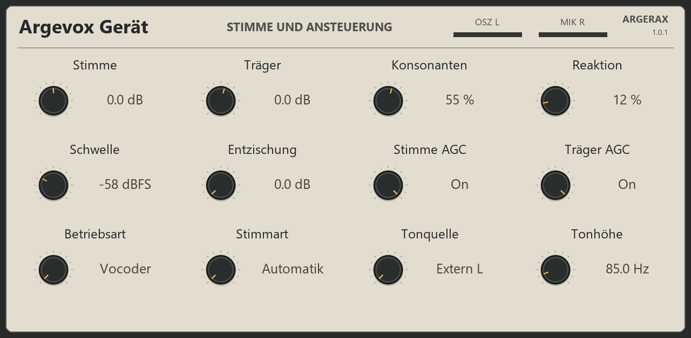

# Argevox Gerät · 1.0.0 beta 2

20-band live vocoder for Akai MPC standalone, developed by **Argerax**, inspired by the functional architecture of the **Sennheiser VSM-201**. Use a microphone as modulator and Mini D or a native MPC oscillator as carrier.

## Manuals

- [English user manual](docs/manual-en.md)
- [Manual de usuario en español](docs/manual-es.md)
- [Deutsches Benutzerhandbuch](docs/manual-de.md)

## Install

Download the manual ZIP from the [beta release](https://github.com/ymn27nhnwd-hue/argevox-geraet/releases/tag/v1.0.0-beta.2), extract it, and copy **Argerax - VST - Argevox Gerät** into **VST2 Plugins** at the root of your drive. Requires **MPC OS 3.10.1 or later**, with **Enable Enhancements** and **External Plugin Support** enabled. The ARMv7 and AArch64 packages are for OpenMPC Plugin Manager.

Route the carrier fully left and the microphone fully right to the same stereo submix, then insert Argevox on that submix. Set microphone monitoring to In. Start with **Klar 201**, then try **Dunkle Stimme** and **Tiefe Maschine**.

This beta replaces the existing Argevox installation. Keep the previous installer and a copy of projects for comparison. The published UID and first 49 parameter identifiers are preserved. Older projects may need new level settings because of the redesigned engine.

## New engine and interface

Twenty synthesis-band gains, twenty filtered-speech amounts and ten paired pause-fill controls. Independent bounded AGCs, automatic tonal/noise excitation, pink noise, multifilter, input monitors, a fixed-frequency internal oscillator, formant shift, darkness, clarity and six presets. The insert uses external audio for a MIDI-played carrier.

Beta 2 groups all controls into **five pages**: STIMME, KLANG, BÄNDER, SPRACHE and PAUSEN. Each page has at least four Q-Link assignments. All twenty synthesis bands fit on one page. All twenty filtered-speech controls also fit on one page. The interface retains German parameter names in every manual edition.

The approximate center frequencies were read from Sennheiser's original Illustration 8. This is a functional digital interpretation; its filters, timing and voicing detector have not been calibrated against a physical VSM-201. The manuals describe the supported functions and the original hardware connections that cannot be exposed through this stereo insert.

## Hardware feedback and validation

The author confirmed beta 1 playback on **MPC One+ with MPC OS 3.10.1**, including chords and dark voices, and highlighted **Klar 201**. Beta 2 uses identical DSP binaries with a revised interface. CPU measurements and installation of the new beta through OpenMPC remain pending. See [hardware test notes](docs/hardware-tests.md).

The SDK host simulator passed 20 checks with zero failures or warnings. Targeted DSP checks cover silence, input monitors, multifilter, noise, pause filling, spectral transfer, formant shift and restoration of the first 49 parameters. Both ARM packages pass the updated OpenMPC catalog validator. See [validation notes](docs/validacion.md).

The plugin binary and package manifests use numeric version **1.0.0**, as required by the packaging tools. GitHub marks this distribution as **v1.0.0-beta.2 prerelease**.

## Build

Built against [inMusic MPC Plugin Builder SDK](https://github.com/inmusic-software/mpc-plugin-builder-sdk/tree/febd2ca5bd9eb16c4a412837196e145566bc981b). Place the repository under the SDK plugins directory, then use its build tools. ARM distributions were compiled with Clang and Arm GNU 13.3 sysroots, with `compat/glibc-strtoul.cpp` and `-Wl,--wrap=__isoc23_strtoul` to avoid a glibc 2.38 dependency. ARMv7 requires glibc 2.32 and AArch64 requires glibc 2.35.

OpenMPC packaging tools are pinned to commit `7199ebf12722f3828b4a4daac38e2cedf666cd0c`, including current installation and uninstallation scripts with LF line endings.

## License and sources

MIT. Copyright © 2026 Argerax for original code and assets. Reused SDK components retain the inMusic copyright and license notices. See [LICENSE](LICENSE).

[Sennheiser original manual, filter-response curves and circuit schematics](https://rubidium.se/~magnus/synths/companies/sennheiser/).
